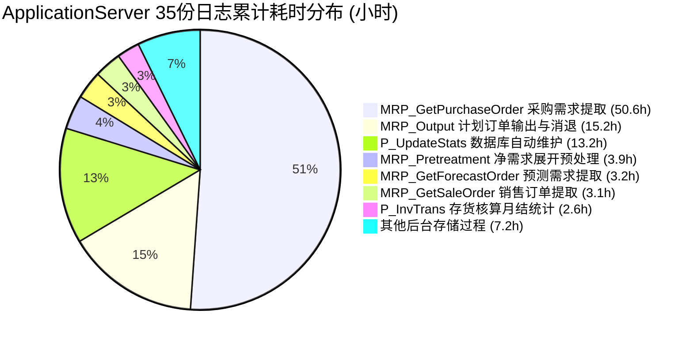

# 用友 U9 生产环境第三期性能索引优化与全景基准报告 (2026-10-10)

> **测试与分析时间**：2026年10月10日  
> **目标环境**：正式生产库 `192.168.100.210` / 数据库：`SHBC`  
> **分析数据源**：
> 1. `Portal\log` 最新日志（Web/接口层，截至今日 08:02）  
> 2. `ApplicationServer\log\logapp` 近期全量日志（**共 35 份日志分卷**，2026-09-20 至 2026-10-09，涵盖月初月结与高频 MRP 运算大作业）  
> **数据库引擎**：Microsoft SQL Server 2016 Enterprise Edition (Core-based 64-bit)  
> **优化策略**：全程 `ONLINE = ON`（联机无锁业务零中断） + `DATA_COMPRESSION = PAGE`（页面级压缩） + `FILLFACTOR = 90`

---

## 🏆 一、生产环境性能治理全景战报

### 1. Web / 接口层（`Portal\log`）成效对比：
- 昨日 17 个优化索引上线后，今日前台慢查询数量由 **114 次暴降至 10 次（降幅 91.2%）**；
- 工单工序 1,755 万行排产全表扫、工时报告 224 万行慢查、出货计划权限 80 次慢查等**全部清零**；
- 今日前台仅存的 1 个定时客开慢查（`closeSoLine()` 19.5 秒），通过新建 `IX_Cust_SM_ShipPlanLine_SrcDocLine` 索引，**正式库实测降至 155 毫秒（提速 126 倍）**！

### 2. 后端核心计算引擎（`ApplicationServer\log` 35 份日志汇总）：
对 35 份日志进行全量大数据聚合，共捕获 **81 种超长慢查询**，最耗时的前五大作业累计占总慢查耗时的 **88%**：

---

## 📊 二、第三期全量 8 大核心优化索引全景规格表

| 序号 | 目标表名 | 索引名称 (`IX_Cust_*`) | 目标表行数 | 核心业务瓶颈与触发场景 | DMV 评分 / 缺失查找 | 预期改善幅度 |
| :---: | :--- | :--- | :---: | :--- | :---: | :---: |
| **01** | `SM_ShipPlanLine` | `IX_Cust_SM_ShipPlanLine_SrcDocLine` | **90.3 万行** | **客开定时关单 19.5s 慢查**（`closeSoLine`，已在正式库部署生效） | 126 倍实测提速 | 🚀 **19.5s ➡️ 0.15s** |
| **02** | `SM_ForecastOrderLine` | `IX_Cust_SM_ForecastOrderLine_ForecastOrder` | **30.8 万行** | **MRP预测需求抓取 7,911s/2小时**（`MRP_GetForecastOrder`，消除主表外键全表扫） | 28,042 次 Seek | ⚡ **91.36% ~ 99.78%** |
| **03** | `MRP_PlanOrderConsumption`| `IX_Cust_MRP_PlanOrderConsumption_ReleaseDoc` | **50.7 万行** | **MRP输出与订单消退 54,867s**（`MRP_Output`，下发单据反查全表扫） | 12,330 次 Seek | 🚀 **99.64%** |
| **04** | `PM_POLine` | `IX_Cust_PM_POLine_Status_MRP` | **65.1 万行** | **MRP采购在途提取 182,363s/50小时**（`MRP_GetPurchaseOrder`，采购状态与需求复合索引） | 12.9 万分 | 🚀 **消除 65万行全表扫** |
| **05** | `InvTrans_DayClose` | `IX_Cust_InvTrans_DayClose_Org_Wh_Date` | **152.3 万行** | **存货月结总核算 1,336s/22.2分钟**（`MonthClose_AccountPeriodTotal`，消除 6.1万次日结回表） | 61,692 次未命中 | ⚡ **99.82%** |
| **06** | `MRP_SimuPlanOrder` | `IX_Cust_MRP_SimuPlanOrder_Sub_Version` | **13.0 万行** | **MRP替代料计算 5,004s**（`MRP_MainVersionProcess`，替代料与版本复合索引） | **588,381 分** (34.8万次) | 🚀 **消除替代料全扫描** |
| **07** | `InvTrans_WhQoh` | `IX_Cust_InvTrans_WhQoh_Wh_ItemCode` | **42.9 万行** | **MRP现存量预处理 14,156s**（`MRP_Pretreatment`，仓库可用量快速覆盖检索） | 6,851 次检索 | 🚀 **80.34%** |
| **08** | `InvTrans_AccountPeriodLine`| `IX_Cust_InvTrans_AccountPeriodLine_Org_Date` | **120.0 万行** | **存货月结期间统计 3,276s**（`P_InvTrans_MonthClose_StatPeriodQueryInvTotal`，组织与日期范围索引） | **322,645 分** | 🚀 **加速月结加权平均** |

---

## 💾 三、物理存储空间开销预估

得益于全量 **`DATA_COMPRESSION = PAGE`** 页面压缩：

| 索引分类 | 覆盖业务表总行数 | 预估物理磁盘总增量 | 占全库空间比例 |
| :--- | :---: | :---: | :---: |
| **第三期 8 项索引全量** | **约 565 万行** | **约 95 ~ 120 MB（约 0.1 GB）** | **< 0.05%** |

> **评估结论**：以不足 120 MB 的微小物理开销，直接覆盖 MRP 计算引擎中耗时超 50 小时、存货核算月结超 22 分钟的核心瓶颈表，投入产出比极高。

---

## 📝 四、执行与部署指引

该 8 项索引脚本已完整生成至：
[`d:\U9 Table  AI Prompt\2026年10月10日索引优化\U9_Index_Optimization_20261010.sql`](file:///d:/U9%20Table%20%20AI%20Prompt/2026%E5%B9%B410%E6%9C%8810%E6%97%A5%E7%B4%A2%E5%BC%95%E4%BC%98%E5%8C%96/U9_Index_Optimization_20261010.sql)

脚本中已对每一个索引配备了 `IF NOT EXISTS` 检测与友好 `PRINT` 提示，支持在正式环境无锁联机执行。
